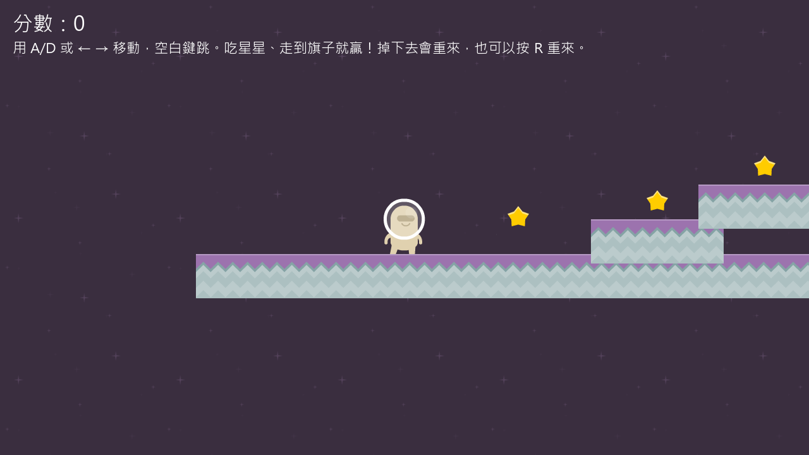
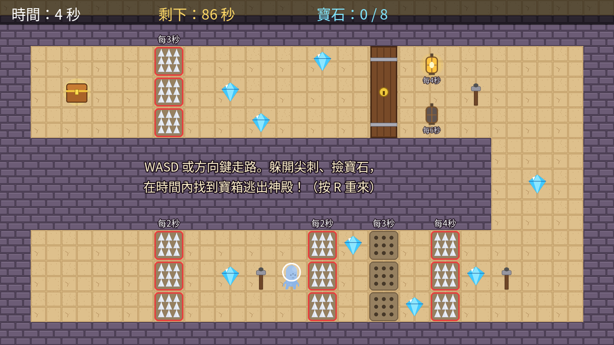

# 🚀 小小遊戲設計師

用 **Godot** 加上 AI 學做遊戲的課程。你不用會寫程式：玩遊戲、找出問題、說清楚、改數字，再驗證結果對不對。

| 關卡 | 資料夾 | 會學到 |
|---|---|---|
| 第 1 關：月球跳跳 | [`01-月球跳跳`](01-月球跳跳) | 控制變因、小數、線對稱、重力 |
| 第 2 關：神殿大逃脫 | [`02-神殿大逃脫`](02-神殿大逃脫) | 倍數、公倍數、最小公倍數、時間計算 |

| 月球跳跳 | 神殿大逃脫 |
|---|---|
|  |  |

## 怎麼開始（第一次要做）

### 1. 安裝 Godot
到 <https://godotengine.org/download> 下載 **Godot 4.7**（標準版就可以，不需要 .NET 版）。
下載後解壓縮，雙擊裡面的 Godot 程式就能打開，不用安裝。

### 2. 下載這個課程
在這個網頁上方按綠色的 **Code** 按鈕 → **Download ZIP**，下載後**解壓縮**。

### 3. 把遊戲匯入 Godot
1. 打開 Godot，會看到「專案管理員」。
2. 按 **匯入（Import）**。
3. 找到剛剛解壓縮的資料夾，進入你要玩的那一關（例如 `01-月球跳跳`），選 **`project.godot`**。
4. 按 **匯入並編輯（Import & Edit）**。

第一次打開會花幾秒鐘整理檔案，等它跑完就好。

每一關都是一個獨立的專案，要玩哪一關就匯入哪一關的 `project.godot`。

### 4. 開始玩
按 **F5**（或右上角的 ▶）。

| | 月球跳跳 | 神殿大逃脫 |
|---|---|---|
| 移動 | `A` / `D` 或 `←` / `→` | `W` `A` `S` `D` 或方向鍵 |
| 跳 | 空白鍵 | （不用跳） |
| 重來 | `R` | `R` |
| 目標 | 吃星星、碰到旗子 | 躲尖刺、撿寶石、在時間內找到寶箱 |

## 上課講義
每一關的 `課本` 資料夾裡有講義：
- `.pdf`：直接印出來寫
- `.docx`：可以用 Word 打開修改

## 和 AI 一起改遊戲（老師陪同時使用）
用 Claude Code 或 Codex **打開某一關的資料夾**，就可以用中文對話改遊戲。
AI 會先讀資料夾裡的 `AGENTS.md`（教學規則）和 `CLAUDE.md`（遊戲結構）。
能在 Godot 的**檢查器**自己改的數字（速度、跳躍力、重力），請自己改，不用問 AI。

## 常見問題
- **打開時說版本不同？** 請用 Godot 4.7。
- **中文變成方塊？** 遊戲用 Windows 內建的「微軟正黑體」。其他電腦可以改 `ui/中文字型.tres` 換成電腦裡有的中文字型。
- **改壞了想重來？** 重新解壓縮一次下載的 ZIP 就好。

## 素材授權
美術與音效來自 [Kenney](https://kenney.nl)，授權 CC0。神殿大逃脫的神殿素材（地板、牆、陷阱、燈籠、大門等）是自己畫的，同樣以 CC0 釋出。
